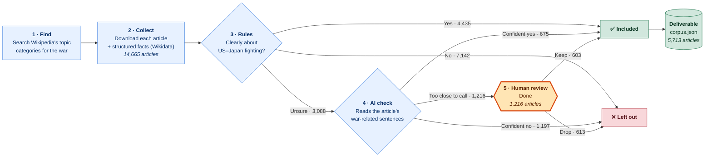
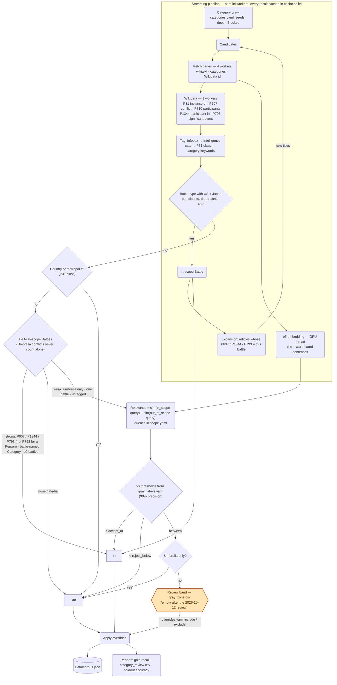

# Pacific War corpus — how it is built

**Goal:** collect every English Wikipedia article about the war between the **United States and Japan in WWII**
(battles, people, ships, units, aircraft, places, events…) and hand it over as one JSON file:
`{ article title: article text }`.

## At a glance

| | |
|---|---|
| **Articles delivered** | **5,713** (115 MB), out of 14,665 examined |
| **Quality check** | 55 / 55 hand-picked must-have articles are included |
| **Accuracy on unclear cases** | ~93% when the AI check is confident (50 of 54 hand-labelled articles it never saw) |
| **Hand decisions** | 1,178 unclear articles reviewed one by one (603 kept, 575 dropped); every reason is in `reports/review_log.tsv` |
| **Run time** | ~5 min from scratch · ~12 s when re-run (everything is cached) |
| **Waiting on people** | **Nothing.** All 3,088 unclear articles are decided (review completed 2026-10-12) |

## The flow

**In plain words**

1. **Find:** start from Wikipedia topic categories such as *Pacific War* or *Battles of WWII involving Japan*,
   skipping noise like films, novels and memorials.
2. **Collect:** download every article found, plus facts from Wikidata (who fought in which battle, and which
   people, units, ships and places Wikidata records as taking part in each battle, which also finds articles
   the categories miss).
3. **Rules:** an article is in if it is a battle where **both** the US and Japan fought, or if it is
   clearly tied to such a battle (a ship that fought at Midway, a general who commanded at Okinawa).
   Films, books and anything with no tie to a US–Japan battle are left out.
4. **AI check:** for articles the rules cannot settle, an AI language model (e5) reads the war-related sentences and
   scores how strongly the article is about US–Japan fighting rather than China, Burma, Europe or civilian life.
5. **Human review:** articles the AI cannot call either way are decided by a person. All 1,216 have been
   decided: 603 kept (mostly US Navy ships, Marines and Pacific airfields) and 613 dropped. Articles tied only to
   a whole war (an "umbrella", see step 3) are dropped automatically instead of waiting for review.

## How each step decides

### Step 3 · Rules: "Clearly about US–Japan fighting?"

Three rules, applied in order. Each article ends up **Yes**, **No** or **Unsure**.

**Rule 1: Culture and media are always out.**
Films, books, games, songs, museums and memorials are *about* the war, not *part of* it.
*Examples:* the film *Letters from Iwo Jima* and the *USS Arizona Memorial* are left out.

**Rule 2: A battle is in when both the US and Japan fought in it, during 1941–1945.**
This covers battles, campaigns and operations. Participants are checked in three independent places,
and any one of them is enough:

- the battle's fact box on Wikipedia (its list of combatants),
- Wikidata's structured list of participants,
- Wikipedia's own categories (*Battles involving the United States* **and** *Battles involving Japan*).

| Example | Result | Why |
|---|---|---|
| Battle of Midway | ✅ Yes | US vs Japan, 1942 |
| Battle of Kohima | ❌ Not by this rule | UK vs Japan, no US forces |
| USS Panay incident | ❌ No | US vs Japan, but 1937, before the war |
| Operation Downfall | ➡ Rule 3 | Invasion of Japan that was cancelled, so it has no combatants; judged by its ties instead |

The battles that pass, **320 of them**, become the **reference list** that every other article is measured against.

**Rule 3: Everything else is judged by its tie to the reference battles.**
This covers people, ships, units, aircraft, weapons, places and events.

| Tie to the reference battles | Result | Example |
|---|---|---|
| **Strong.** Wikidata records that it took part in one (as its conflict, as a battle it participated in, or as a significant event in its history), *or* it is filed under a category named after one, *or* it links to **two or more** of them | ✅ **Yes** | *Chester Nimitz* (took part in Midway) · *Richard E. Cole* (Doolittle Raid) · *Banzai Cliff* (Saipan) · *USS Arizona* (filed under *Attack on Pearl Harbor*) · *USS Enterprise* (dozens of battles) |
| **Weak.** Tied only to a whole war, *or* to exactly **one** battle, *or* its kind can't be determined | ❓ **Unsure** → step 4 | *USS Bache* (only Leyte Gulf) · a Japanese general tied only to the *Second Sino-Japanese War* |
| **None** | ❌ **No** | *Dwight Eisenhower* (Europe) · Atlantic convoy ships |

Why weak ties are not enough on their own:

- **A whole war is too broad.** The *Pacific War*, the *Second Sino-Japanese War* and the *Burma campaign* include a
  great deal of fighting without the US, for example Chinese generals and British regiments. Counting a tie to a whole war as proof
  let in about 800 off-topic articles, so these "umbrella" wars can only *support* a tie, never be the only one.
- **One link is often a passing mention.** Eisenhower's article mentions Pearl Harbor once.
- **For people, a "significant event" is often one they only witnessed.** Wikidata lists the atomic bombings as a
  significant event of dozens of photographers and artists, so for people that claim is only a weak tie.
- **Countries and metropolises are tied to everything.** *United States*, *Australia*, *Tokyo* and *Bangkok* link
  to many battles without being about the fighting, so they are always left out unless a reviewer includes them.
  Ordinary cities such as *Hiroshima* or *Rabaul* are battle sites and are judged normally.

**Outcome:** 4,435 Yes · 7,142 No · 3,088 Unsure.

### Step 4 · AI check: "Is this article really about US–Japan fighting?"

For the 3,088 unsure articles, an AI language model (**e5**) reads the article's war-related sentences, meaning every
sentence that names a theatre or a side (Japan, Pacific, Okinawa, China, Burma, Atlantic…). It compares them with two
descriptions written in plain English:

- ✅ *"An American or Japanese ship, unit, person, aircraft or place that took part in the fighting between the
  United States and Japan in the Pacific."*
- ❌ *"The war in China, Burma, Europe or the Atlantic, or civilian life, not involving combat between the
  United States and Japan."*

The article gets a score for how much closer it is to the first description than to the second. Two cut-offs turn
the score into a decision. They were first set from about 80 articles labelled by hand; the review decisions from
step 5 now count as labels too (about 1,200 in total), and the cut-offs barely moved:

| Score | Decision | Count |
|---|---|---|
| High: at least 90% of labelled articles at this level belonged | ✅ Include | 675 |
| Low: at least 90% of labelled articles at this level did not belong | ❌ Leave out | 1,197 |
| In between | ➡ Human review (step 5) | 1,216 |

The cut-offs were then tested on a **second, separate set of 68 hand-labelled articles** that played no part in
setting them, and are never used to set them. **93%** (50 of 54) of the AI's confident decisions were correct.
Typical AI misses are people whose war service is a small part of their biography, such as a baseball player who fought on Iwo Jima.

### Step 5 · Human review: "Keep or drop?"

A reviewer opens the review list (`gray_zone.csv` or the app's Review tab, most likely articles first) and marks each
article *keep* or *drop*. The decisions are saved in one small file (`overrides.yaml`) and:

- beat every rule and the AI on all future runs,
- are reused to tune the AI's cut-offs, so the review list gets shorter over time (except for the 68 test articles,
  which are kept out of tuning so the accuracy check stays honest).

**How the 2026-10-12 review decided.** *Keep* means the article's subject served in, or was directly part of, the
fighting between the US and Japan in 1941–45. *Drop* covered Atlantic-only US ships, ships that reached the Pacific
only after the surrender, fighting between Japan and Britain, Australia, the Netherlands or China with no US forces,
Japanese officers who served only in China, photographers, artists and civilian survivors, memorials and postwar
bases. Each decision and its one-line reason is in `Processing/reports/review_log.tsv`.

**Umbrella-only articles are dropped without review.** If the AI cannot call an article and its only tie is to a
whole war (the umbrella list in `scope.yaml`), it is left out automatically; 38 articles were dropped this way.
A reviewer can still bring one back with an override.

## Where people are needed

| Task | How often | Effort | Why it matters |
|---|---|---|---|
| Review new "too close to call" articles | After a re-run finds new articles | Usually a handful | The first full pass (1,216 articles) is done |
| Check noisy topic categories | After big changes | Minutes | Keeps the search focused |
| Label a sample of unclear articles | Rarely | ~80 articles | Keeps the AI check honest and measurable |
| Confirm the must-have list | Rarely | Minutes | Guarantees key articles are never lost |

Every human decision is saved in a small config file and applied automatically on the next run.

## Open decisions

- **British ships in US-led operations.** British Pacific Fleet ships that fought alongside US forces are currently
  *in* (*HMS Howe*, *HMS Indomitable* and the *King George V* class, which joined the Okinawa operation). *HMS Duke of
  York*, which arrived too late to fight, is out. If British-only crews should be out entirely, flip these in
  `overrides.yaml`.

---

<b>Technical detail (for engineers)</b>

Terms are defined in `CONTEXT.md`; all config lives in `Processing/config/`. Where each rule lives in the code:
[`RULES.md`](RULES.md).

| Waiting on | Look at | Edit |
|---|---|---|
| Review band | `Data/interim/gray_zone.csv` (`decision = review`) | `config/overrides.yaml` (reasons in `reports/review_log.tsv`) |
| Noisy discovery | `Data/interim/category_review.csv` (`suggest_block`) | `config/categories.yaml` → `blocked` |
| Missing gold article | Gold-recall report in the notebook | `config/categories.yaml` seeds, or a rule |
| Threshold quality | Holdout line in the notebook | `config/gray_labels.yaml` |
| What a change did | `Data/interim/changes.csv` (articles added / removed vs the previous run) | the rule or config you changed |

Gray-zone overrides are added to the calibration labels automatically, except for titles in the `holdout` section of
`gray_labels.yaml`, so the holdout accuracy is never measured on articles that tuned the cut-offs.

